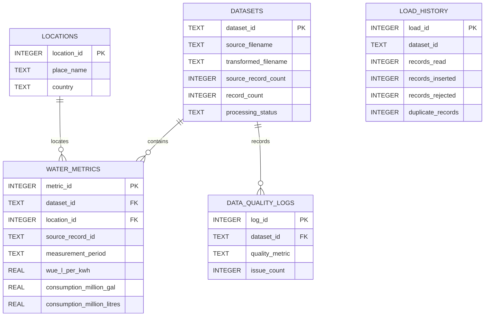

# PureFlow SQLite database

## Architecture

Flask uses Python's built-in `sqlite3` driver for short-lived connections. The database is stored at `backend/database/aquaintel.db`; initialization applies `backend/database/schema.sql` idempotently and never removes existing rows. Connections enable foreign-key enforcement and a busy timeout. Write operations use `BEGIN IMMEDIATE`, parameterized statements, bounded batches, and rollback on error. The SQLAlchemy helper also enables foreign keys for every engine connection.

The loader reads only standardised files from `backend/data/transformed/` whose filename identifies the requested dataset. It checks dataset provenance against the upload metadata index, maps known column names explicitly, inspects dtypes, coerces only declared measurements, drops exact duplicate rows with a count, and rejects rows without a source ID, place label, or any supported numeric measurement. Each source row is retained as one `water_metrics` observation, with its distinct reported quantities and units preserved. Each batch uses `executemany`. Reload is a separate user action; it requires `reload=true` and `confirm=true`, and replacement plus insertion happen in one transaction.

### Current load snapshot

The existing transformed `data-center-water.csv` source was loaded into the requested database: 85 rows read, 85 inserted, 0 rejected, and 0 exact duplicates. The database has 74 distinct location labels. Validation reports `integrity_check = ok`, no foreign-key violations, no required-field NULLs, no duplicate keys, and matching source/stored counts. Climate and water-stress tables are absent because those measurements are not in this transformed dataset.

## Tables and relationships

| Table | Purpose | Keys and important constraints |
| --- | --- | --- |
| `datasets` | Upload and transformed-file provenance and stored/source counts. | `dataset_id` primary key; counts are nonnegative. |
| `locations` | Distinct source place labels and optional source country code. | `location_id` primary key; unique normalized place and country. Place labels are not asserted to be cities or data centres. |
| `water_metrics` | One row per accepted source record, preserving scope, metric type, original period, and explicitly named measurements. | `metric_id` primary key; foreign keys to dataset and location; unique `(dataset_id, source_record_id)`. |
| `load_history` | Auditable successful, skipped, and failed load attempts with source/read/insert/reject/duplicate counts. | `load_id` primary key; intentionally retains history across an explicit dataset reload. |
| `data_quality_logs` | Per-load counts of rejected and exact duplicate transformed rows. | `log_id` primary key; foreign key to datasets. |

`load_history.dataset_id` is intentionally not a foreign key: a failed load must remain auditable even when its dataset transaction rolls back. Analytical denormalisation is limited to keeping the different source water measures together on their source observation row; this avoids losing row context and avoids inventing a common unit. No climate or water-stress table is created because the inspected transformed source has no compatible climate or water-stress fields. The source includes geographic labels and water values but does not establish climate-station links or water-risk assessments.

## Source mapping

The inspected transformed CSV has 85 source rows and columns including `id`, `publisher`, `metric`, `scope`, `facility_or_region`, `country`, `period`, `wue_l_per_kwh`, withdrawal/discharge/consumption in million gallons, consumption in million litres, and prompt-level measures. The loader maps those exact source names in `backend/app/services/database_loader.py`. `facility_or_region` becomes a neutral `place_name`; no city, region, or facility classification is inferred. Blank country values stay NULL. `period` is retained verbatim, with a parsed year only when the entire source value is a four-digit year and a parsed month only for explicit month/year or year-month values.

WUE is stored only in `wue_l_per_kwh` and never added to water volume. Million gallons and million litres are not added together. Values reported per prompt remain separate from volume totals. Unmapped source metadata remains in the transformed file and is not guessed into analytical columns.

## Analytical SQL

`backend/database/queries.sql` documents the reusable query shapes. The Flask analytics service runs the same parameterized SQL against current stored data:

- Consumption totals return separate sums and observation counts for million gallons and million litres.
- WUE averages group by location and country and remain in L/kWh.
- Country comparison groups consumption by country while preserving both units.
- Monthly and annual trends include only records with explicit parseable periods; no date is fabricated from retrieval or publication metadata.
- Dashboard summaries report loaded datasets and stored observation counts.
- Climate and water-stress endpoints return clear empty messages until compatible linked source fields exist.

The country comparison is not a climate correlation, and no causal claim is calculated. The data's `scope='site'` can support a count of source site labels if desired, but does not prove that each label is a distinct data centre.

The custom query endpoint accepts one `SELECT` or read-only CTE, executes on a SQLite read-only connection, uses SQLite's authorizer to deny writes and schema changes, and caps output at 500 rows (the UI requests 200). Query parameters can be supplied as a JSON array.

Generated report history and export artifacts are stored under `backend/data/reports/<report_id>/` rather than as report rows in SQLite. Each report is a point-in-time JSON snapshot accompanied by CSV and PDF exports. The report ID is a validated UUID hex string and the file format is allow-listed before the backend constructs a download path.

## Validation

The validation API checks required tables, required-column NULLs, primary/natural-key duplication, foreign keys using `PRAGMA foreign_key_check`, database structure using `PRAGMA integrity_check`, and stored row counts against `water_metrics`. Loading reports source rows read, inserted, rejected, exact duplicates, timestamp, status, and source filenames. These counts reconcile as `read = inserted + rejected + duplicate` for successful loads. Rejections and duplicates are also recorded in `data_quality_logs`; an unsuccessful transaction is rolled back and does not leave partial dataset rows.

## Limitations and assumptions

- The current transformed source contains annual, monthly, fiscal, and descriptive period labels. Only exact years and explicit month/year values participate in annual/monthly trend queries.
- Place names may describe a site, cloud region, fleet, or a broader geography. They are stored as labels and are not reverse-geocoded.
- Countries can be missing and are not inferred from place names.
- Climate, water-stress, and coordinates are not present in the inspected transformed source, so those analyses correctly return empty results.
- Consumption and WUE are only available for subsets of source records; NULL means the source did not provide that measure.
- The database path in the supplied brief was absent from this workspace at implementation time. The specified path was created and populated without modifying any other database file.
