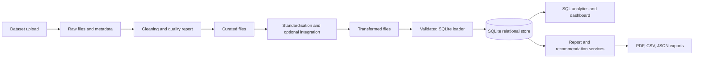

# PureFlow project overview

**Full title:** PureFlow – Water Consumption and Sustainability Analytics Platform  
**Tagline:** Smarter Water Insights. Sustainable Tomorrow.

## Purpose

PureFlow is a data analytics platform designed to analyse water consumption in data centres, assess data quality, identify missing values and duplicates, clean and transform datasets, and generate meaningful insights to support sustainable water management. The Flask and React application provides a workflow from upload and quality assessment through cleaning, standardisation, SQLite storage, SQL analytics, and evidence-based sustainability reporting.

## System architecture

- **Frontend:** React, Vite, Axios, React Router, and Recharts.
- **Backend:** Flask JSON APIs with Pandas-based file inspection and transformations.
- **Storage:** uploaded, curated, quality-report, and transformed files under `backend/data/`; normalized SQLite database at `backend/database/aquaintel.db`.
- **Reporting:** a rule-based Python service creates a report snapshot and PDF, CSV, and JSON exports under `backend/data/reports/`.

## Implemented capabilities

- Upload and inspect CSV, Excel, and Parquet files.
- Profile and clean data conservatively; missing and ambiguous values are reported rather than invented.
- Standardise curated columns and integrate only through selected join keys.
- Load transformed records into SQLite with provenance, explicit metric mappings, foreign keys, transaction rollback, duplicate handling, and validation.
- Run read-only, bounded custom SELECT queries and SQL-backed analytics.
- Generate sustainability reports and evidence-linked recommendations from stored data, with dataset, location, and source-period year filters.
- Download generated reports in PDF, CSV, and JSON; review report history.

Climate, coordinates, and water-stress analysis are implemented as API/UI empty states because the currently loaded transformed dataset has no compatible climate or linked water-stress measures. The current app does not produce a sustainability score or certification.

## Run locally

Start the backend from `backend` with `python run.py`. Start the frontend from `frontend` with `npm run dev`. The frontend expects the Flask API at `http://localhost:5000/api` unless `VITE_API_BASE_URL` is configured.

See [data_pipeline.md](data_pipeline.md), [database_design.md](database_design.md), and [analytical_methodology.md](analytical_methodology.md) for implementation detail.
